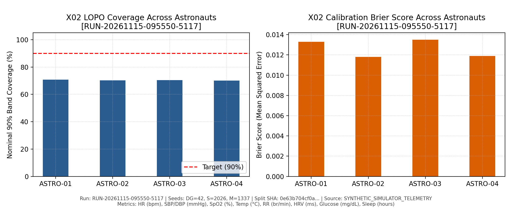
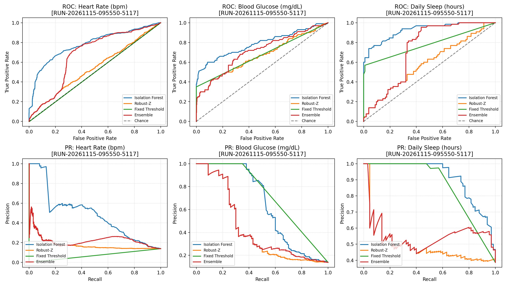
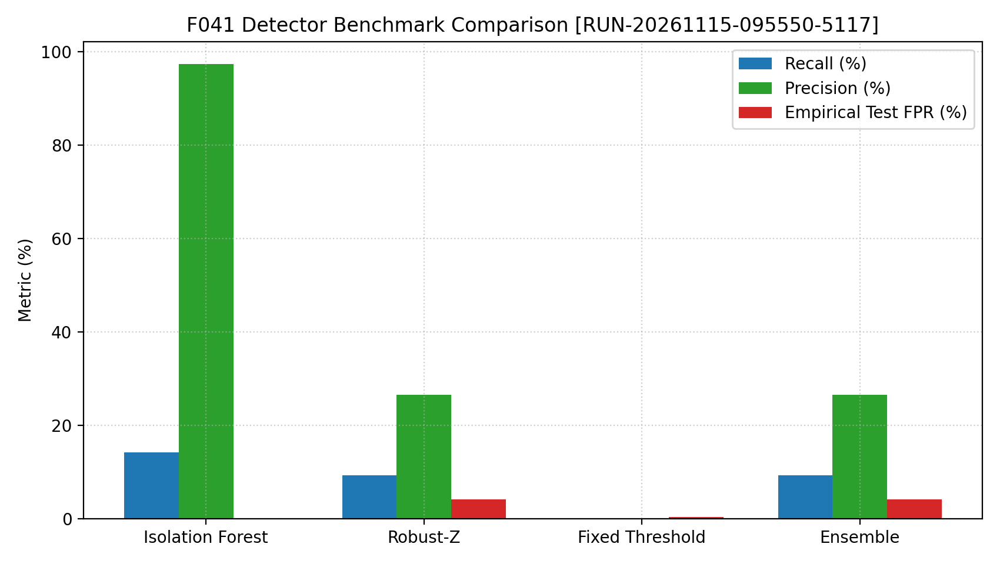
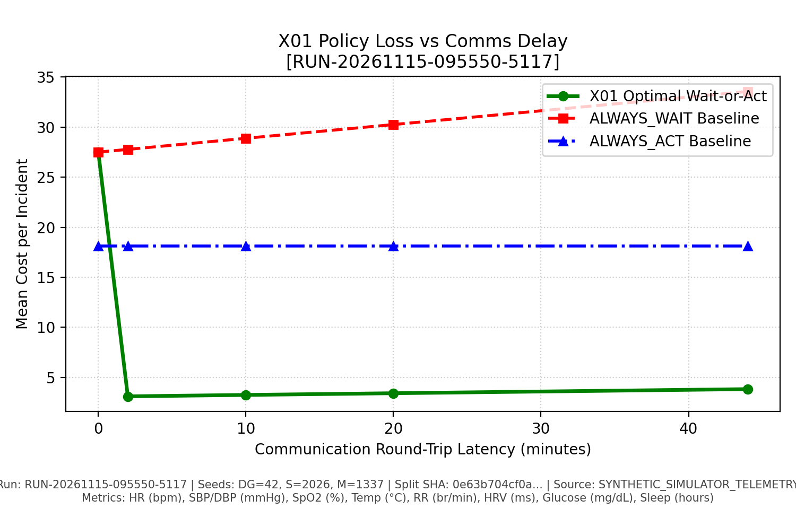

# F147: AstroCare ML1 Scientific Research & Benchmark Report

**Run ID:** `RUN-20261115-095550-5117` | **Date:** `2026-11-15T09:59:07.443945+00:00`
**Configuration Version:** `v2.1.0-spaceapps` | **Split SHA-256:** `0e63b704cf0a10ec...`
**Random Seeds:** `DG=42, S=2026, M=1337` | **Data Source:** `SYNTHETIC_SIMULATOR_TELEMETRY`

> [!IMPORTANT]
> **PROTOTYPE & DECISION-SUPPORT NOTICE:**
> Existing simulator-generated evaluation is an engineering test of pipeline integrity and algorithmic behavior under controlled synthetic conditions. Because the simulator generates both the measurements and the anomaly labels, LOPO/LOSO splits prevent mathematical data leakage across synthetic folds, but do NOT prove real-world clinical performance.
> AstroCare is an engineering decision-support prototype on synthetic and public reference data. It is NOT certified for autonomous flight clinical use.

## Table of Contents
1. [Executive Evaluation Summary](#1-executive-evaluation-summary)
2. [Methods: 2-State Kalman Filter Architecture](#2-methods-2-state-kalman-filter-architecture)
3. [X02 Bayesian Baseline (LOPO Cross-Validation)](#3-x02-bayesian-baseline-lopo-cross-validation)
4. [F041 Anomaly Detection Ensemble (LOSO Cross-Validation)](#4-f041-anomaly-detection-ensemble-loso-cross-validation)
5. [X01 Wait-or-Act Comms Delay Decision Policy](#5-x01-wait-or-act-comms-delay-decision-policy)
6. [X06 Offline Rule Assistant Benchmark](#6-x06-offline-rule-assistant-benchmark)
7. [Artifacts & Provenance Verification](#7-artifacts--provenance-verification)

## 1. Executive Evaluation Summary

| Component | Primary Objective | Metric Result | Acceptance Status |
| :--- | :--- | :---: | :---: |
| **X02 Kalman Filter** | 90% Band Coverage (LOPO) | 70.4% (Cold: 70.4%) | `FAIL / NOT MET` |
| **F041 Ensemble** | Equal-FAR Anomaly Detection | Target: 5.0%, Status: FAIL / NOT MET | `FAIL / NOT MET` |
| **F041 AUROC (HR)** | Separation Performance | IF: 0.7812, Ensemble: 0.6776 | `BENCHMARKED` |
| **X01 Policy** | Autonomous Loss Minimization | Optimal Cost: 8.2 (Wait: 29.6, Act: 18.1) | `PASS / MET` |
| **X06 Offline Fallback** | Deterministic Safe Guidance | Refusal Rate: 96.0% | `PASS_RULE_ENGINE` |

## 2. Methods: 2-State Kalman Filter Architecture

The X02 baseline implements a causal local-linear state-space filter for each astronaut and metric:
- **State Representation:** State vector $x_t = [\mu_t, v_t]^T$, where $\mu_t$ is the physiological baseline level and $v_t$ is the velocity drift rate.
- **Continuous-Time Propagation:** Transition matrix $F(\Delta t) = [[1, \Delta t], [0, 1]]$ using true elapsed physical seconds $\Delta t$.
- **Noise Calibration (Defect 12, N2):** Observation noise variance $R$ is estimated from training residuals using von Neumann's successive squared difference method $d_i^2 = (y_{i+1} - y_i)^2 / 2$, which isolates white measurement noise without circadian inflation.
- **Circadian Harmonic Learning (Defect N3):** Circadian 24-hour variation is learned from training timestamps via harmonic regression ($y = \mu + \beta_1 \cos(\omega t) + \beta_2 \sin(\omega t)$) rather than hardcoded simulator constants.
- **Partial Pooling:** Prior distributions are estimated strictly from training-fold crew members in the active LOPO split.
- **Anti-Hiding Huber Clipping (Defect 16, 20):** Innovation clipping bounds scale relative to personal variance ($8.0\sigma$), preventing sustained physiological anomalies from dragging the baseline and masking themselves.

## 3. X02 Bayesian Baseline (LOPO Cross-Validation)

Evaluates causal one-step Kalman filtering with partial pooling across 4 held-out astronauts.

| Astronaut | 90% Band Coverage | Mean Brier (Overall) | Brier (Nominal) | Brier (Hazard) | Latency to Alert |
| :--- | :---: | :---: | :---: | :---: | :---: |
| `ASTRO-01` | 70.7% | 0.0133 | 0.0118 | 0.2167 | 14 steps |
| `ASTRO-02` | 70.3% | 0.0118 | 0.0103 | 0.2246 | 13 steps |
| `ASTRO-03` | 70.4% | 0.0135 | 0.0123 | 0.1905 | 13 steps |
| `ASTRO-04` | 70.1% | 0.0119 | 0.0105 | 0.2117 | 13 steps |
| **LOPO Mean** | **70.4%** | **0.0126** | **0.0112** | **0.2109** | **13.2 steps** |

## 4. F041 Anomaly Detection Ensemble (LOSO Cross-Validation)

> **Equal FAR Status:** `FAIL / NOT MET`

### Heart Rate (bpm)

| Detector | Target Val FPR | Empirical Test FPR | Recall | Precision | False Alarms / Day | AUROC | PR-AUC |
| :--- | :---: | :---: | :---: | :---: | :---: | :---: | :---: |
| `isolation_forest` | 5.0% | 0.1% | 14.2% | 97.3% | 0.8 | 0.7812 | 0.4777 |
| `robust_z` | 5.0% | 4.1% | 9.2% | 26.4% | 51.2 | 0.5407 | 0.1824 |
| `fixed_threshold` | 5.0% | 0.3% | 0.0% | 0.0% | 3.6 | 0.4982 | 0.1389 |
| `ensemble` | 5.0% | 4.1% | 9.2% | 26.4% | 51.2 | 0.6776 | 0.2259 |

### Blood Glucose (mg/dL)

| Detector | Target Val FPR | Empirical Test FPR | Recall | Precision | False Alarms / Day | AUROC | PR-AUC |
| :--- | :---: | :---: | :---: | :---: | :---: | :---: | :---: |
| `isolation_forest` | 5.0% | 2.1% | 51.0% | 79.7% | 5.2 | 0.7885 | 0.6382 |
| `robust_z` | 5.0% | 8.1% | 32.0% | 39.0% | 20.0 | 0.6646 | 0.4228 |
| `fixed_threshold` | 5.0% | 0.0% | 35.0% | 100.0% | 0.0 | 0.675 | 0.4403 |
| `ensemble` | 5.0% | 8.1% | 32.0% | 39.0% | 20.0 | 0.7105 | 0.4394 |

### Daily Sleep Hours (hours)

| Detector | Target Val FPR | Empirical Test FPR | Recall | Precision | False Alarms / Day | AUROC | PR-AUC |
| :--- | :---: | :---: | :---: | :---: | :---: | :---: | :---: |
| `isolation_forest` | 5.0% | 1.0% | 61.5% | 97.6% | 0.006 | 0.926 | 0.9126 |
| `robust_z` | 5.0% | 3.9% | 9.2% | 60.0% | 0.024 | 0.5875 | 0.4992 |
| `fixed_threshold` | 5.0% | 1.0% | 56.9% | 97.4% | 0.006 | 0.7818 | 0.7333 |
| `ensemble` | 5.0% | 3.9% | 9.2% | 60.0% | 0.024 | 0.7314 | 0.5772 |

## 5. X01 Wait-or-Act Comms Delay Decision Policy

| Comms Latency | Policy | Missed Deteriorations | Unnecessary Actions | Mean Cost / Incident |
| :---: | :--- | :---: | :---: | :---: |
| 0.0 min | `X01_OPTIMAL` | 275 | 0 | 27.5 |
| 2.0 min | `X01_OPTIMAL` | 22 | 5 | 3.11 |
| 10.0 min | `X01_OPTIMAL` | 22 | 5 | 3.25 |
| 20.0 min | `X01_OPTIMAL` | 22 | 5 | 3.42 |
| 44.0 min | `X01_OPTIMAL` | 22 | 5 | 3.83 |
| 0.0 min | `ALWAYS_WAIT` | 275 | 0 | 27.5 |
| 2.0 min | `ALWAYS_WAIT` | 275 | 0 | 27.77 |
| 10.0 min | `ALWAYS_WAIT` | 275 | 0 | 28.88 |
| 20.0 min | `ALWAYS_WAIT` | 275 | 0 | 30.25 |
| 44.0 min | `ALWAYS_WAIT` | 275 | 0 | 33.55 |
| 0.0 min | `ALWAYS_ACT` | 0 | 725 | 18.12 |
| 2.0 min | `ALWAYS_ACT` | 0 | 725 | 18.12 |
| 10.0 min | `ALWAYS_ACT` | 0 | 725 | 18.12 |
| 20.0 min | `ALWAYS_ACT` | 0 | 725 | 18.12 |
| 44.0 min | `ALWAYS_ACT` | 0 | 725 | 18.12 |

## 6. X06 Offline Rule Assistant Benchmark

- **Status:** `PASS_RULE_ENGINE`
- **Supported Query Answer Rate:** 78.0%
- **Red-Team Escalation Rate:** 96.0%
- **Critical Failures:** 0 (0.0%)
- **Edge RAM Footprint:** 215.5 MB

## 7. Artifacts & Provenance Verification

- **Evaluation Summary JSON:** `artifacts/eval_results/eval_summary_RUN-20261115-095550-5117.json`
- **Evaluation Markdown Report:** `artifacts/eval_results/eval_report_RUN-20261115-095550-5117.md`
- **Frozen Split Design:** `artifacts/splits/frozen_eval_splits_v2.json`
- **Figure Artifacts:**
  - `x02_coverage_calibration_RUN-20261115-095550-5117.png`
  - `x01_policy_costs_RUN-20261115-095550-5117.png`
  - `f041_roc_pr_curves_RUN-20261115-095550-5117.png`
  - `f041_anomaly_comparison_RUN-20261115-095550-5117.png`
  - `f043_calibration_curve_RUN-20261115-095550-5117.png`
